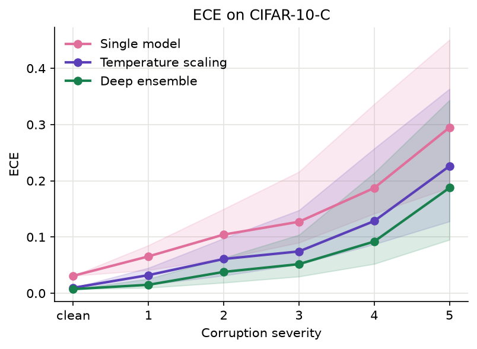
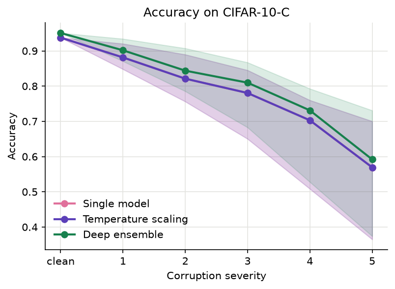
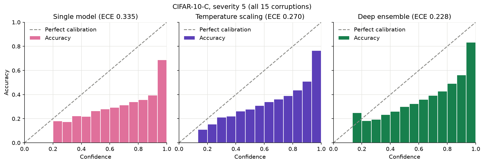

# Calibration under distribution shift: CIFAR-10 to CIFAR-10-C

[](https://github.com/TiaraAnnaJain/cifar10c-calibration/actions/workflows/ci.yml)

This project compares three ways of getting predictions, a
**single model**, **temperature scaling** and a **deep ensemble**, on clean CIFAR-10 and
on CIFAR-10-C (15 corruptions × 5 severities). It is a small-scale reproduction of the
CIFAR-10 experiments in Ovadia et al. (2019).

## Key findings

- **The trained models are overconfident, and temperature scaling fixes that on clean
  data:** the fitted temperature is 1.41–1.48 for every seed, and scaling cuts clean ECE
  from 3.1% to 1.0% without changing accuracy.
- **Calibration degrades sharply under shift for every method:** the single model's
  median ECE grows from 3.1% on clean data to 29.5% at severity 5.
- **Temperature scaling's benefit shrinks as shift grows:** on clean data it nearly
  matches the ensemble (ECE 1.0% vs 0.7%). 
  - At severity 5 the gap is 22.6% vs 18.7%, and
    the ensemble has lower ECE than temperature scaling on all 75 corrupted test sets.
- **The deep ensemble is the most accurate and best calibrated method at every
  severity.** 
  - One exception: on NLL, temperature scaling beats the ensemble on 12 of the
    75 corrupted sets, including the median at severity 5 (1.72 vs 1.73).
- **The type of corruption matters more than the method:** At severity 5 the ensemble's
  ECE ranges from 1.2% (brightness) to 51.7% (Gaussian noise). 
  - The noise corruptions are
    the worst for every method.

## Results

| Method | Clean accuracy | Clean ECE | Clean NLL | Severity 5 accuracy | Severity 5 ECE | Severity 5 NLL |
|---|---|---|---|---|---|---|
| Single model | 93.8 ± 0.3% | 3.1 ± 0.3% | 0.222 | 56.9% | 29.5% | 2.28 |
| Temperature scaling | 93.8 ± 0.3% | 1.0 ± 0.2% | 0.193 | 56.9% | 22.6% | **1.72** |
| Deep ensemble (5 models) | **95.1%** | **0.7%** | **0.156** | **59.2%** | **18.7%** | 1.73 |

Single-model and temperature-scaling rows are the mean ± standard deviation over 5
seeds. Severity 5 values are the median over the 15 corruptions, after averaging over
seeds. Every number, for all 4 metrics, 3 methods, 5 seeds and 76 test sets, is in
[`results/results.csv`](results/results.csv).



Lines are the median over the 15 corruptions, and the shaded bands cover the middle 50%
of corruptions.





At severity 5 every method is overconfident: all the bars sit below the diagonal.
These diagrams pool all 15 corruptions for seed 0, so their ECEs differ slightly from
the medians in the table.

NLL and Brier score plots, and reliability diagrams on clean data, are in
[`results/figures/`](results/figures/).

## Comparison to Ovadia et al. (2019)

The main conclusions reproduce:

- Accuracy and calibration both get worse as the shift increases, for every method.
- Temperature scaling gives low ECE on in-distribution data, but its ECE rises steeply
  with shift. Calibrating on an i.i.d. validation set does not guarantee calibration
  under shift.
- Deep ensembles are the most accurate under shift and the best calibrated at larger
  shifts.

Differences in setup, which mean absolute numbers should not be compared directly:

| | This project | Ovadia et al. |
|---|---|---|
| Architecture | ResNet-18 (CIFAR variant) | ResNet-20 |
| Ensemble size | 5 | 10 |
| Corruptions | 15 types × 5 severities | 16 types × 5 severities |
| ECE bins | 15 equal-width bins | quantile bins |
| Methods | single, temperature scaling, ensemble | also MC dropout, SVI and last-layer variants |
| Summary across corruptions | median and interquartile range | box plots |

## Limitations

- One architecture and one dataset.
- Five seeds give a single five-member ensemble, so the ensemble rows have no error bars.
- ECE depends on the binning scheme; this project uses 15 equal-width bins throughout.
- Only three methods are compared.

## Method

- **Model:** ResNet-18 adapted for 32×32 images (3×3 stride-1 first convolution, no
  max-pool), trained from scratch.
- **Training:** SGD (momentum 0.9, weight decay 5e-4), learning rate 0.1 with cosine
  decay, batch size 128, 40 epochs, random crop (padding 4) and horizontal flip.
  Settings are in [`configs/resnet18_cifar10.toml`](configs/resnet18_cifar10.toml).
- **Data split:** 45,000 training / 5,000 validation images from the CIFAR-10 training
  set, with a fixed split shared by every seed. The 10,000-image test set is never used
  for any fitting.
- **Temperature scaling:** a single temperature per model, fitted by minimising NLL on the
  validation set only.
- **Deep ensemble:** 5 models trained from different seeds; their predicted probabilities
  are averaged.
- **Metrics:** accuracy, expected calibration error (ECE, 15 equal-width bins), negative
  log-likelihood and Brier score.
- **Shift:** CIFAR-10-C (Hendrycks & Dietterich, 2019), the 15 benchmark corruptions at
  severities 1–5.

## Reproducing

Requires [uv](https://docs.astral.sh/uv/) and Python 3.13.

```bash
uv sync
uv run python scripts/download_cifar10c.py       # 2.9 GB, into data/CIFAR-10-C
uv run python scripts/train.py --seed 0          # repeat for seeds 0-4 (GPU recommended)
uv run python scripts/predict.py                 # logits for val, test and CIFAR-10-C
uv run python scripts/evaluate.py                # writes results/results.csv
uv run python scripts/make_plots.py              # writes results/figures/
```

CIFAR-10 downloads automatically on first use. Each script accepts `--fast-dev-run` to
check the whole pipeline in seconds on a few images.

Training and prediction were run on Kaggle T4 GPUs: about 25 minutes per seed to train,
and about 11 minutes to predict with all 5 seeds across two GPUs. See
[`notebooks/`](notebooks/). Evaluation and plotting run on a laptop from the saved logits.
Trained checkpoints are available on the
[releases page](https://github.com/TiaraAnnaJain/cifar10c-calibration/releases).

## Repository layout

```
configs/                  training settings (TOML)
notebooks/                Kaggle notebooks used for training and prediction
results/                  results.csv and figures
scripts/                  train, predict, evaluate, make_plots, download_cifar10c
src/cifar10c_calibration/
    data/                 CIFAR-10 and CIFAR-10-C loaders, transforms, train/val split
    calibration/          metrics, temperature scaling, ensembling
    models.py             CIFAR ResNet-18
    engine.py             training loop and inference
    prediction.py         run a model on every evaluation set
    evaluation.py         build the results table
    plots.py              figures
tests/                    pytest suite, run in CI with ruff and mypy
```

## References

- Y. Ovadia et al. *Can You Trust Your Model's Uncertainty? Evaluating Predictive
  Uncertainty Under Dataset Shift.* NeurIPS 2019.
- D. Hendrycks and T. Dietterich. *Benchmarking Neural Network Robustness to Common
  Corruptions and Perturbations.* ICLR 2019.
- C. Guo et al. *On Calibration of Modern Neural Networks.* ICML 2017.
- B. Lakshminarayanan et al. *Simple and Scalable Predictive Uncertainty Estimation using
  Deep Ensembles.* NeurIPS 2017.
- K. He et al. *Deep Residual Learning for Image Recognition.* CVPR 2016.

## License

[MIT](LICENSE)